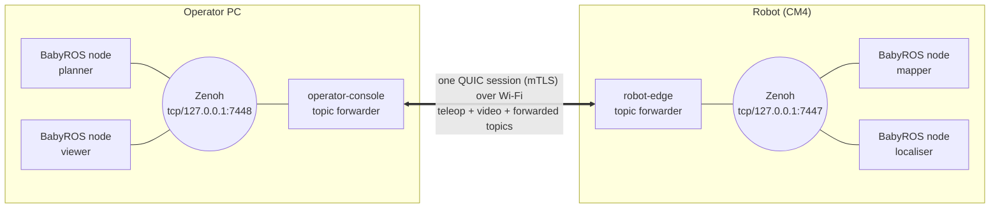
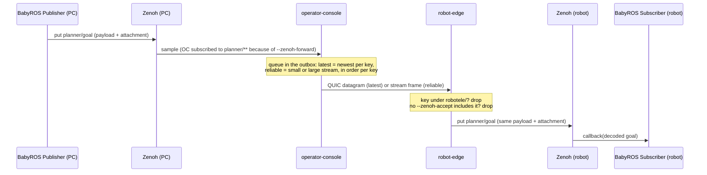
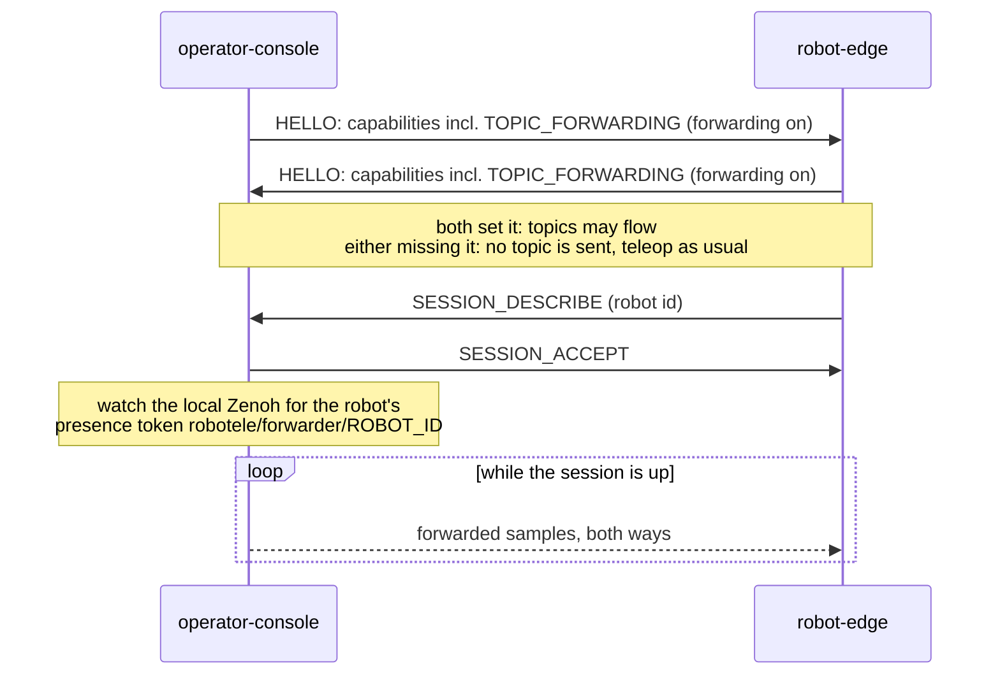
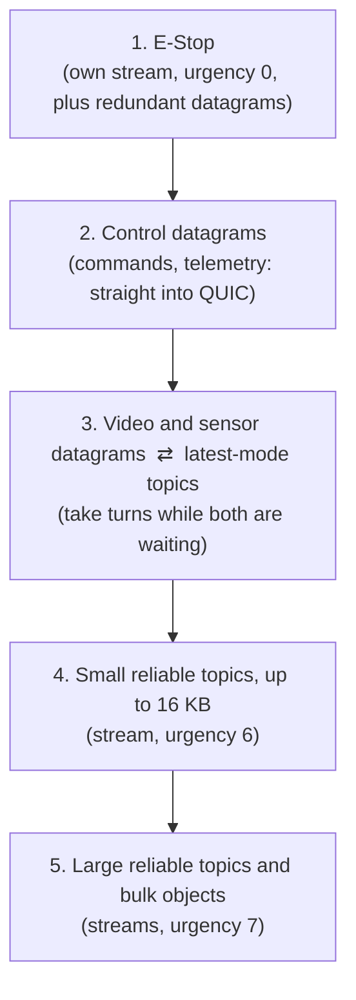
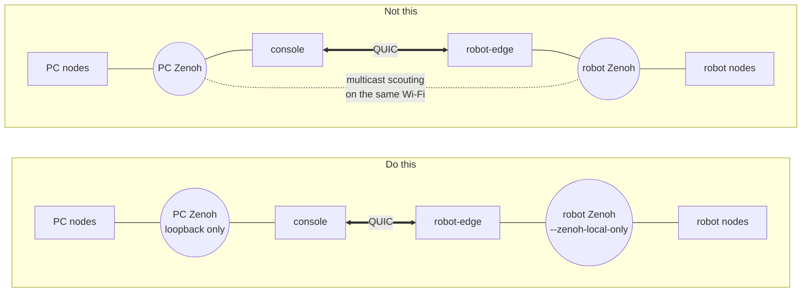

# BabyROS over RoboTele: topic forwarding

How to run [BabyROS](https://github.com/telekinesis-ai/babyros) nodes on the
operator's PC and on the robot so they talk to each other across RoboTele's QUIC
session, with no change to the nodes' code. This doc explains how it works and how
to deploy it. [BABYROS.md](../BABYROS.md) is the reference: every flag, the limits,
and the raw measurements. Background is in discussion
[#36](https://github.com/spinworks-tech/robotele/discussions/36).

## TL;DR

- **Zenoh on each side, RoboTele across the link.** Each host keeps its own Zenoh,
  and BabyROS nodes use it as they always do. `operator-console` and `robot-edge`
  carry the topics you list between the two Zenoh domains, inside the session that
  already carries teleop.
- **Teleop is never affected by the choice.** Commands, E-Stop and video don't go
  through Zenoh, and forwarded samples queue behind them on the link.
- **Two modes per topic.** `latest` for small state that only matters while fresh
  (pose, status); `reliable` for anything that must arrive (goals, maps).
- **Allowlists both ways.** Each side republishes only the keys it accepts, and
  nothing by default.
- **Keep the two Zenoh domains apart** (`--zenoh-local-only` on the robot, no
  multicast scouting on the PC), or samples would loop. The console detects that
  case and pauses forwarding.
- **Measured on the XGO-Lite's CM4 over 2.4 GHz Wi-Fi, with real BabyROS 0.1.10
  nodes:** every payload type decodes on the far side, and every reliable round
  trip arrived with a median of 73-94 ms uncapped, about 160 ms under the default
  2 Mbps cap.

## How it works

### The pieces



- Each host's Zenoh is its own **domain**. The BabyROS nodes on a host connect to
  that host's endpoint and nothing else.
- On each side, a **forwarder** (in `operator-console` and in `robot-edge`)
  subscribes to the key expressions it was told to forward, and sends each sample to
  the other side. The other side checks the key against its allowlist and puts the
  sample on its own Zenoh under the same key.
- The payload and its attachment travel byte for byte. BabyROS's codec (JSON,
  numpy, Arrow IPC with lz4) is decoded only by the receiving node, so it works
  unchanged.

### One sample's path

A planner on the PC publishes a goal; a node on the robot subscribes to it.



The forwarders' subscriptions only take samples published by *other* Zenoh
sessions. A sample that `robot-edge` republishes on the robot is therefore never
picked up by `robot-edge`'s own subscriptions and sent back, even when the robot also
forwards that key.

### Session setup

Forwarding is negotiated when the session starts, through a capability bit in
HELLO. Each side only sends topic samples if both turned forwarding on.



An older console or robot-edge, or one started without forwarding, advertises no
such bit. Teleop then works exactly as before, and the side with forwarding on logs
that the peer doesn't forward topics. Samples captured before the session reaches
this point are discarded, so a reconnect doesn't deliver stale data.

### How forwarded traffic shares the link

On the robot's uplink, where video and sensor data compete for the Wi-Fi, traffic
goes out in this order:



- QUIC packets carry datagrams before stream data, so under heavy video or sensor
  load the reliable topics get what's left.
- **Two reliable streams** per direction: samples up to 16 KB go on the small one,
  which is sent first, so a 300 KB map doesn't hold up a goal. A key's samples stay
  on the large stream while it has one waiting there, so samples of one key never
  overtake each other.
- **The rate cap** (`--zenoh-max-mbps`, default 2 Mbps per direction) limits
  forwarded bytes in total. While it binds, latest samples wait and newer ones
  replace them, and reliable samples wait in a backlog that holds about 2 s at the
  capped rate. See [Choosing the cap](#choosing-the-cap).

## Deploying it

### Topology

The one rule: **the PC's Zenoh and the robot's Zenoh must not reach each other
directly.** Only the QUIC session joins them.



In the second case every forwarded sample would reach the far side twice, by Zenoh
directly and by RoboTele, and loop between the two forwarders. `robot-edge` declares
a liveliness token, `robotele/forwarder/<robot-id>`, on the robot's Zenoh. When the
console can see that token on the PC's own Zenoh, the domains are joined: the console
pauses forwarding in both directions, logs a warning, and its HUD row shows `PAUSED`.
It resumes by itself once the token disappears.

What keeps them apart:

| Side | Setting |
| --- | --- |
| robot | `robot-edge --zenoh-local-only`: its Zenoh listens on `127.0.0.1:7447` (`--zenoh-port`) only, with multicast scouting off |
| PC | `operator-console` listens on `tcp/127.0.0.1:7448` only, with multicast scouting off (the default; `--zenoh-listen` or `--zenoh-config` to change it) |
| nodes, both sides | connect explicitly to their own host's endpoint, with multicast scouting off |

### 1. The robot

Build and deploy robot-edge as usual ([06 — XGO-Lite guide](06-xgo-lite-guide.md)):

```bash
xgo_bridge/scripts/deploy.sh pi@<robot-ip> --release
```

BabyROS needs Python 3.11 or 3.12. The CM4's Debian 11 ships 3.9; `uv` installs a
standalone 3.11 in the pi user's home without touching the system Python:

```bash
python3 -m pip install --user uv
~/.local/bin/uv python install 3.11
~/.local/bin/uv venv --python 3.11 ~/babyros-venv
VIRTUAL_ENV=~/babyros-venv ~/.local/bin/uv pip install babyros
```

Write the robot's rules in a topics file, for example `~/robot-topics`:

```text
# what the robot sends to the operator
forward latest   robot/pose
forward latest   robot/status/**
forward reliable robot/map/**
# what it accepts from the operator
accept planner/**
# per direction; 0 = no cap
max-mbps 2
```

Start robot-edge with it:

```bash
cd ~/RoboProtocol
./target/release/robot-edge --zenoh-local-only --zenoh-topics ~/robot-topics
```

Every rule also has a flag (`--zenoh-forward latest:robot/pose`,
`--zenoh-accept 'planner/**'`, `--zenoh-max-mbps 2`), and flags and files combine.

### 2. The operator PC

```text
# ~/operator-topics
forward reliable planner/**
accept robot/**
```

```bash
./target/release/operator-console --connect <robot-ip>:4433 --server-name robot-edge \
    --zenoh-topics ~/operator-topics
```

### 3. The BabyROS nodes

Same code on both sides; only the endpoint differs (`7448` on the PC, `7447` on the
robot). Call this before creating any node:

```python
import babyros

babyros.configure(connect_endpoints=["tcp/127.0.0.1:7448"],
                  scouting_multicast_enabled=False)
# configure() starts from a fresh config, which drops BabyROS's default
# timestamping, and its timestamping_enabled_* arguments fail with Zenoh 1.10
# (telekinesis-ai/babyros#15). Set it on the stored config instead:
babyros.node.SessionManager.get_session_config().insert_json5("timestamping/enabled", "true")
```

From then on, ordinary BabyROS:

```python
from babyros.node import Publisher, Subscriber

goal = Publisher("planner/goal")
goal.publish({"x": 1.0, "y": 2.0})

Subscriber("robot/pose", lambda pose: print(pose["x"], pose["y"]))
```

### 4. Checking it works

| Where | What to look for |
| --- | --- |
| robot-edge log at start | `forwarding zenoh topic` per forward rule, `accepting forwarded zenoh topic` per accept rule, and the cap |
| both logs at session start | `zenoh topic forwarding negotiated with the robot` / `... with the operator` |
| console HUD | a `C (zenoh in)` row: samples per second received and sent, and the cap |
| robot-edge log at session end | `zenoh topic forwarding at session end`: samples sent, superseded, dropped and rejected |

## Choosing modes

| Data | Mode | Why |
| --- | --- | --- |
| Pose, velocity, status, small sensor summaries | `latest` | Only the newest value matters. A lost or superseded sample costs nothing. It must fit in one datagram, about 1.4 KB including its key; larger ones are dropped and counted. |
| Goals, commands to planners, events | `reliable` | Must arrive, in order. Small, so they use the fast lane. |
| Maps, point clouds, images | `reliable` | Must arrive whole. Over 16 KB they use the large lane. Keep the rate modest: a 300 KB map every 2 s is 1.2 Mbps. |
| Video | neither | Use RoboTele's own video channel; it decodes and drops frames properly. |
| Teleop commands | neither | Use the console. Forwarded topics are below control in priority on purpose. |

Arrow IPC (BabyROS's encoding for telekinesis datatypes) adds overhead even to small
samples, so check a topic's real size before choosing `latest`.

## Choosing the cap

The cap exists because forwarded volume can delay commands on a weak link. On a
degraded Wi-Fi link, 100 KB reliable samples five times a second in each direction,
uncapped, coincided with the robot's watchdog latching. It also has a cost, and on
the CM4 its benefit to control isn't shown yet:

| Real BabyROS workload, CM4 Wi-Fi | Reliable back | Reliable p50 | Grids |
| --- | --- | --- | --- |
| one reliable stream, no cap | 396/396 | about 150 ms | 12 |
| one reliable stream, 2 Mbps cap | 301-327/396 | 3-4 s | 8 |
| two reliable streams, no cap | 396/396 | 73-94 ms | 12 |
| two reliable streams, 2 Mbps cap | 384-396/396 | 159-166 ms | 9-10 |

Two streams made the cap affordable: a map no longer holds up the small samples
behind it. The cap still costs some latency and grids next to no cap. Full numbers,
including earlier runs where the watchdog latched with no forwarded traffic at all,
are in [BABYROS.md](../BABYROS.md), "Measured on the CM4" and "Real BabyROS nodes".

Rule of thumb: keep the total you forward each way well under what the link carries
next to video. On the CM4's 2.4 GHz Wi-Fi, doc 14 measured RoboTele's datagram
ceiling at about 8-12 Mbps.

## Safety rules

- **Keys under `robotele/` are never forwarded or republished.** They belong to
  robot-edge's own Zenoh sidecar, and `robotele/<id>/autonomy_goal` asserts
  semi-autonomy ([03 — Safety & Control](03-safety-and-control.md)), so a forwarded
  topic can never assert it.
- **Accepting is opt-in.** With no `accept` rule, a side republishes nothing. A
  rejected key is logged once and counted.
- **The peer is authenticated by mTLS,** the same certificates as the teleop session.
  There is no per-topic authorization beyond the allowlist.
- **Forwarding can't block a control tick.** Both directions go through bounded
  queues that drop rather than wait.

## Troubleshooting

| Symptom | Cause | Fix |
| --- | --- | --- |
| HUD shows `PAUSED`; log says the Zenoh domain is connected to the robot's directly | the two domains reach each other | `--zenoh-local-only` on the robot; turn off multicast scouting in the PC's nodes |
| "this robot-edge doesn't forward zenoh topics" | the robot has forwarding off, or is an older build | start robot-edge with forwarding rules; deploy this build |
| Samples reach the forwarder but never the far side's nodes | no `accept` rule includes the key (log: "the peer forwarded a key no --zenoh-accept includes") | add an `accept` rule on the receiving side |
| `zenoh.ZError: Str("unknown key")` from `babyros.configure()` | `timestamping_enabled_*` argument (telekinesis-ai/babyros#15) | drop that argument; set `timestamping/enabled` as in [step 3](#3-the-babyros-nodes) |
| A latest topic never arrives | sample over one datagram (`latest_oversize` in the session-end log) | use `reliable` for it |
| Reliable topics arrive seconds late | the cap is binding (`--zenoh-max-mbps`), or the link is saturated by video or sensors | lower the forwarded rate, raise the cap, or reduce the sensor load |
| Nothing arrives right after connecting | samples captured before the session started are discarded on purpose | publish after the session is up; latest topics refresh by themselves |

## Not carried yet

- BabyROS `Server`/`Client` (queries)
- `list_topics` (liveliness): each side only lists its own nodes
- `TRANSIENT_LOCAL` history for late joiners
- Zenoh timestamps: the far side's samples carry none. The robot has no real-time
  clock and no NTP offline, so its clock can be days off anyway.

## Code

| What | Where |
| --- | --- |
| Wire format, outbox, reliable lanes, rate cap | `crates/roboprotocol-core/src/topic.rs` |
| Zenoh side: rules, allowlist, loop detection | `crates/roboprotocol-zenoh/src/lib.rs` |
| QUIC side, shared by both binaries | `crates/roboprotocol-zenoh/src/link.rs` |
| robot-edge wiring | `crates/robot-edge/src/quic_server.rs` |
| console wiring | `crates/operator-console/src/quic_client.rs` |
| Tests on the robot | `benchmark/topic_forwarding_wifi.sh`, `benchmark/babyros/` |
