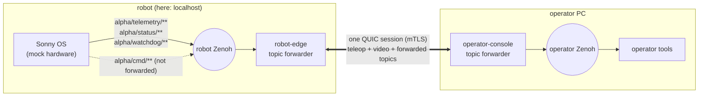

# Sonny OS alongside RoboTele

[Sonny OS](https://github.com/JackTrainer/Sonny) is a Rust microkernel built on
Zenoh, with an XGO-Lite 2 profile that drives the same STM32 register UART our
`xgo_bridge/` uses. Discussion
[#10](https://github.com/spinworks-tech/robotele/discussions/10) listed four ways to
combine the two projects. This doc records what Sonny's code does today (commit
`8ba9ad0`, 2026-08-28), which of those options can work, and a localhost run of
Sonny behind RoboTele's topic forwarding ([doc 15](15-babyros-topic-forwarding.md)).

## TL;DR

- **Sonny's telemetry crosses RoboTele with no code changes.** robot-edge forwards
  `alpha/telemetry/**`, `alpha/status/**` and `alpha/watchdog/**` from Sonny's Zenoh
  to the operator's. In a 20 s localhost run, all 2,111 forwarded samples arrived,
  with telemetry at 100 Hz.
- **Commands stay on RoboTele.** We don't forward `alpha/cmd/**`. Sonny's own control
  loop publishes on that key every 10 ms, so anything we published there would be
  overwritten. Teleop keeps going through Channel B and its deadman.
- **Sonny must not drive our XGO yet.** Its control loop sends all-zero joint
  targets at 100 Hz, and on the XGO profile its watchdog trips about 20 times a second.
  Each trip sends ACTION 255 (reset). Details are under [Problems found in Sonny](#problems-found-in-sonny).
- **Two options from #10 are blocked.** Sonny's WASM registry is a placeholder with
  no runtime. Sonny is AGPL-3.0, and this repo is PolyForm Noncommercial, so we can't
  link or copy its XGO driver.

## The options from #10

| # | Option | Status |
|---|---|---|
| 1 | Run RoboTele inside Sonny (Sonny's author suggested compiling our QUIC stack to WASM for `src/registry`) | **Blocked.** `registry/wasm_runner.rs` has no WASM engine. `evaluate_reward` returns `bytecode.len() % 3` and never runs the module. quiche also needs BoringSSL and UDP sockets, which a WASM sandbox wouldn't provide. |
| 2 | Run alongside Sonny: Sonny's Zenoh for robot-side traffic, RoboTele across the link | **Works for telemetry** (this doc). Commands are not forwarded; see below. |
| 3 | Use Sonny's Rust XGO UART driver in robot-edge in place of `xgo_bridge/` | **Blocked by licensing** (AGPL-3.0 vs PolyForm Noncommercial). The register protocol is xgolib's, so a native driver of our own is possible without Sonny's code. That's a separate piece of work. |
| 4 | Head-to-head benchmark on the XGO | **On hold.** Sonny's author asked to wait, and it can't run on the robot until the problems below are fixed. |

## How it fits together



Sonny publishes raw little-endian `f32` vectors: joint values, then IMU and battery
slots on the XGO profile. Status and watchdog topics carry JSON. robot-edge
forwards these keys in `latest` mode: each sample matters only until the next one
arrives, the same as the pose in doc 15.

### Robot side

```bash
./target/release/robot-edge \
    --zenoh-forward 'latest:alpha/telemetry/**' \
    --zenoh-forward 'latest:alpha/status/**' \
    --zenoh-forward 'latest:alpha/watchdog/**'
```

This runs without `--zenoh-local-only`. Sonny opens Zenoh with
`zenoh::Config::default()`, so it finds peers only by multicast scouting and has no
way to set an endpoint. On the CM4, that would make the robot's Zenoh reachable from
the Wi-Fi network, the setup doc 15 warns against. Sonny would need to read a Zenoh
config (`ZENOH_CONFIG` or a key in its HAL JSON) before this can be deployed on the
robot the way doc 15 recommends.

### Operator side

```text
# ~/operator-topics
accept alpha/telemetry/**
accept alpha/status/**
accept alpha/watchdog/**
```

```bash
./target/release/operator-console --connect <robot-ip>:4433 --server-name robot-edge \
    --zenoh-topics ~/operator-topics
```

## What we ran

[`scripts/sonny_mock_forwarding.sh`](../scripts/sonny_mock_forwarding.sh) starts
robot-edge (`--stub-bridge`), operator-console (`--headless`) and Sonny without a
config. In that mode Sonny simulates a 6-DOF arm, `MockRobot`, and never opens a
serial port. A `zenoh_probe` subscriber on each side counts samples. Sonny isn't
vendored here; the script takes the path to a binary you built.

20 s on one laptop, localhost:

| Key | Published by Sonny | Arrived at the operator |
|---|---|---|
| `alpha/telemetry/MockRobot` | 2,000 (100 Hz, 24 B) | 2,001 |
| `alpha/status/MockRobot` | 80 | 80 |
| `alpha/watchdog/status/MockRobot` | 30 | 30 |
| `alpha/cmd/MockRobot` | 2,030 | 0 (not forwarded) |
| `alpha/cmd/MockRobot/estop` | 60 | 0 (not forwarded) |

robot-edge reported `latest_sent=2111 latest_superseded=0`, which matches what
arrived. The extra telemetry sample at the operator is one published as the robot-side
subscriber was stopping.

## Problems found in Sonny

We found these by reading the code and running it on a laptop. None of them is
specific to RoboTele.

1. **`main` doesn't build.** Commit `0ce9447` deleted `src/chaos/`, but `src/lib.rs`
   still declares `pub mod chaos;`, and `src/bin/chaos_test.rs` still uses it. We
   removed that line locally and built only the `SONNY` binary.
2. **The control loop overwrites external commands.** `RealTimeControlLoop`
   (`diagnostics/frequency_enforcer.rs`) publishes `alpha/cmd/{id}` every period,
   taking it from the WASM output buffer, or zeros when the buffer is empty. Since the
   registry never produces a command, that's zeros. The serial HAL writes every
   `alpha/cmd/{id}` sample to the robot, so another publisher on that key is replaced
   within one period.
3. **On the XGO, those zeros are joint targets.** With `dof: 12`, the zero vector
   encodes as a MOTOR_ANGLE write of 0 rad to all 12 leg servos, sent at the loop
   rate. Sonny's own adapter comment calls that pose "an unsafe crouch".
4. **The watchdog trips on ordinary jitter.** The heartbeat timeout (10 ms) equals
   the 100 Hz loop period, so a tick 1 ms late trips it. On a laptop without
   `SCHED_FIFO` it tripped 30 times in 20 s. The XGO profile runs the loop at 50 Hz
   (20 ms) with the same fixed 10 ms timeout. Pointed at a serial port that doesn't
   exist, it tripped 129 times in about 6 s. Each trip publishes a zero command and an
   E-Stop. On the XGO the E-Stop is ACTION 255, which resets the robot. The latch
   releases on its own when the heartbeat returns.
5. **The watchdog doesn't watch the link.** The heartbeat comes from Sonny's own
   control loop, not from any remote input, so losing the operator doesn't trip it.
   It complements RoboTele's deadman; it doesn't replace it.
6. **The jitter check measures the wrong interval.** It compares how long a frame's
   work took (10-179 µs, median 61 µs) with the full period, so it logs "Frame out of
   window" on every frame (2,001 in the 20 s run).

## Next steps

- Report problems 1-4 and 6 upstream, with this run as the reproduction.
- Once Sonny accepts commands from outside its own loop, or the registry runs real
  WASM, decide whether RoboTele should hand teleop to Sonny on the robot. Until then
  teleop stays robot-edge → `xgo_bridge/`.
- A native Rust XGO driver for robot-edge (option 3, written from xgolib's register
  map rather than from Sonny's code) is worth a separate discussion.
